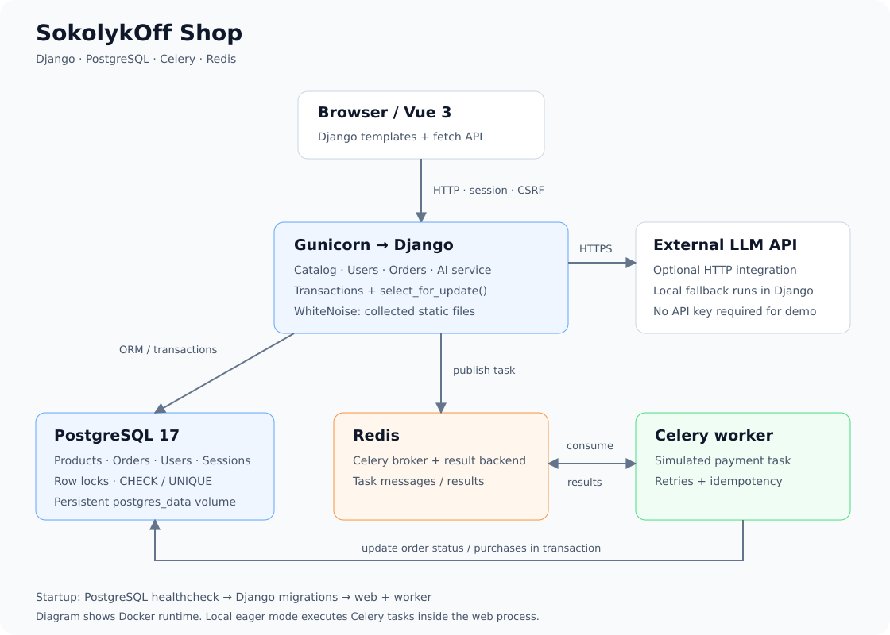

# SokolykOff Shop — E-Commerce Backend (Django 5.2 + PostgreSQL 17 + Celery/Redis)

[](https://github.com/SokolykOff/sokolykoff-shop/actions/workflows/ci.yml)


Backend интернет-магазина электроники с транзакционным резервированием складских остатков в PostgreSQL, фоновой обработкой заказов через Celery/Redis и гибридным AI-поиском с детерминированным локальным фоллбэком.



---

## 1. Технологический стек и архитектура

| Компонент | Технология | Инженерное назначение |
|---|---|---|
| **HTTP API & Static** | Django 5.2, Gunicorn, WhiteNoise | Обработка JSON API каталога, заказов и авторизации; раздача собранного фронтенда (`frontend-pkg`) |
| **База данных** | PostgreSQL 17 (`READ COMMITTED`) | Транзакционное хранение каталога, пользователей и заказов; строгие ограничения целостности на уровне СУБД |
| **Очередь задач** | Celery + Redis 7 | Асинхронная постобработка заказов после коммита транзакции (`transaction.on_commit`), хранение статуса задач в Redis |
| **AI & Поиск** | OpenAI-compatible API + Rule-Based Engine | Парсинг бюджета из естественного языка, исправление раскладки и опечаток, AI-подбор и кэшируемая сводка по отзывам |
| **Контейнеризация и CI** | Docker Compose, GitHub Actions | Выделенный `migrate`-контейнер с ожиданием `pg_isready`, прогон тестов на PostgreSQL 17 и полный `docker-smoke` |

---

## 2. Гарантии транзакционности и надёжности (Safety & Concurrency Guarantees)

| Механизм | Реализация в коде | От какого риска защищает |
|---|---|---|
| **Row-Level Locking & Deadlock Prevention** | `select_for_update()` внутри `transaction.atomic()` с предварительной сортировкой ID товаров по возрастанию (`ORDER BY id`) | Исключает гонки списания остатков (overselling) при параллельных покупках и взаимные блокировки (deadlocks) при пересекающихся корзинах |
| **Database-Level Constraints** | `CheckConstraint` (`stock >= 0`, `total_price >= 0`, `quantity > 0`), `UniqueConstraint(order, product)`, индекс `(user_id, created_at DESC)` | Гарантирует невозможность ухода остатков в минус или дублирования позиций даже при прямом обращении к БД |
| **Idempotent Order Cancellation** | Блокировка строки заказа через `select_for_update()`, проверка текущего статуса и атомарный возврат единиц товара в `stock` | Повторный или параллельный запрос отмены не может начислить товар на склад дважды |
| **Post-Commit Celery Dispatch** | Вызов `.delay()` обёрнут в `transaction.on_commit()` в `orders/services.py` | Celery-воркер гарантированно читает уже зафиксированный в PostgreSQL заказ, исключая гонку между коммитом и чтением |
| **Atomic Purchase Counters** | Обновление популярности товара через SQL-выражение `F("purchases_count") + quantity` в `orders/tasks.py` | Параллельные воркеры не затирают счётчик покупок при одновременном выполнении задач |
| **Resilient AI Fallback** | Таймаут 2.5 с, лимит длины промпта, кэширование сводок до изменения отзывов и детерминированный локальный ранжировщик | Витрина и умный подбор продолжают работать без задержек и ошибок даже без `LLM_API_KEY` или при недоступности внешнего LLM-провайдера |

---

## 3. Карта API эндпоинтов

| Метод | Эндпоинт | Назначение |
|---|---|---|
| `GET` | `/api/products/` | Список товаров с фильтрацией, поиском и пагинацией |
| `GET` | `/api/products/<id>/` | Детальная карточка товара и список отзывов |
| `POST` | `/api/products/<id>/reviews/` | Добавление или обновление отзыва (требует авторизации, 1 отзыв на товар от пользователя) |
| `GET` | `/api/products/<id>/ai-summary/` | Кэшируемая AI-сводка плюсов, минусов и вердикта по отзывам товара |
| `POST` | `/api/ai/recommend/` | Гибридный AI-подбор товаров по текстовому запросу и бюджету |
| `POST` | `/api/auth/register/` | Регистрация пользователя |
| `POST` | `/api/auth/login/` | Вход в сессию (защита от перебора паролей через Django cache) |
| `POST` | `/api/auth/logout/` | Завершение сессии |
| `GET` | `/api/auth/me/` | Профиль текущего пользователя |
| `GET` | `/api/orders/` | История заказов пользователя |
| `POST` | `/api/orders/` | Транзакционное создание заказа с резервированием остатков и постановкой Celery-задачи |
| `POST` | `/api/orders/<id>/cancel/` | Идемпотентная отмена заказа с возвратом товара на склад |
| `GET` | `/api/orders/tasks/<task_id>/` | Проверка статуса фоновой задачи заказа в Redis (доступно только владельцу заказа) |

---

## 4. Структура проекта

```text
sokolykoff-shop/
├── backend/
│   ├── mysite/              # Настройки Django, PostgreSQL, Celery, безопасности и логов
│   ├── catalog/             # Модели каталога, гибридный поиск, AI-сервис и API товаров
│   ├── orders/              # Транзакционный сервис заказов (services.py), Celery-задачи и тесты
│   ├── fixtures.json        # Демонстрационные данные каталога
│   ├── requirements.txt     # Зависимости приложения
│   └── requirements-lock.txt
├── frontend-pkg/            # Пакет со статикой клиентского интерфейса (Vue 3 SPA)
├── docs/
│   └── architecture.svg     # Схема архитектуры
├── Dockerfile               # Непривилегированный образ (UID 10001) с Gunicorn
├── docker-compose.yml       # PostgreSQL 17, Redis 7, migrate, web и Celery worker
└── .github/workflows/ci.yml # Пайплайн: PostgreSQL 17 тесты + Docker Compose smoke-тест
```

---

## 5. Быстрый старт

### Запуск через Docker Compose (рекомендуется)

```bash
docker compose up --build -d
```

Сервис `migrate` дождётся готовности PostgreSQL 17, применит миграции и загрузит демонстрационные данные каталога, после чего запустятся `web` (Gunicorn + WhiteNoise) и `worker` (Celery).

* Приложение: `http://localhost:8000`
* Проверка логов: `docker compose logs -f web worker`
* Остановка: `docker compose down`

### Локальная разработка и запуск тестов

```bash
# 1. Поднять PostgreSQL 17 и Redis 7
docker compose up -d db redis

# 2. Установить зависимости (из каталога backend)
cd backend
python -m venv .venv
source .venv/bin/activate  # Windows: .venv\Scripts\activate
pip install -r requirements-lock.txt

# 3. Задать подключение к БД
export POSTGRES_DB=sokolykoff_shop
export POSTGRES_USER=sokolykoff
export POSTGRES_PASSWORD=local-dev-password
export POSTGRES_HOST=127.0.0.1
export POSTGRES_PORT=5432

# 4. Применить миграции, загрузить каталог и запустить тесты
python manage.py migrate
python manage.py loaddata fixtures.json
python manage.py test -v 2
```

---

## 6. Автотесты и CI

GitHub Actions пайплайн (`.github/workflows/ci.yml`) автоматически проверяет каждый коммит в двух джобах:
1. **`test` (PostgreSQL 17):** применение миграций, загрузка фикстур, `collectstatic --noinput` и полный набор тестов Django (`catalog` + `orders`), включая многопоточный тест конкурентной покупки последнего товара (`stock = 1`) и конкурентной отмены заказа через `Barrier`.
2. **`docker-smoke`:** сборка production-образа, подъём всего стека через `docker compose`, проверка HTTP-ответов и сквозной прогон реальной фоновой задачи `web → Redis → Celery worker → Redis`.
